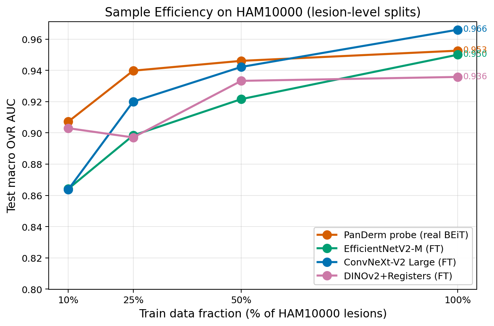
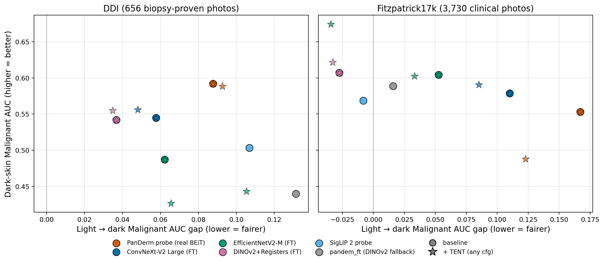
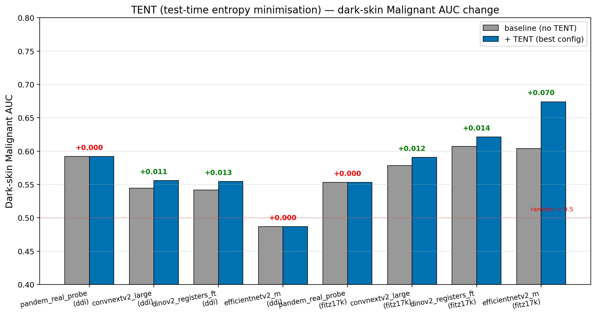
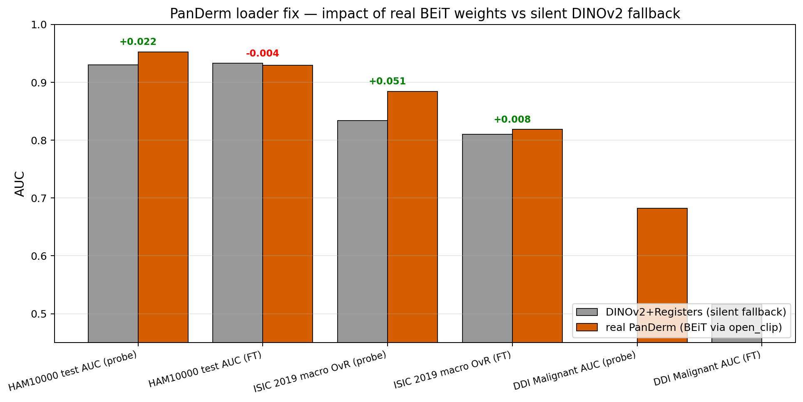

# Skin Lesion v2 — Results Report

> Auto-generated from `experiments/` artifacts on 2026-05-18 07:33 UTC.

This document captures the headline numbers, figures, and recipe from the v2 (lesion-level-splits, cross-dataset audited) iteration of the skin lesion classification project. For project context, see [`Skin_Lesion_Project_Complete_Guide.md`](Skin_Lesion_Project_Complete_Guide.md); for findings + publishability discussion, see [`FINDINGS.md`](FINDINGS.md).

## TL;DR

| Metric | Value | Where |
|---|---:|---|
| HAM10000 test macro OvR AUC (best ensemble) | **0.9733** | `experiments/post_hoc/results.txt` |
| HAM10000 best single model (ConvNeXt-V2) | 0.9660 | `experiments/convnextv2_large/results.txt` |
| ISIC 2019 cross-dataset best | 0.8845 | `pandem_real_probe` (probe-only) |
| DDI dark-skin Malignant AUC, TENT-aware SLSQP ensemble | 0.6571 | `experiments/cross_dataset_ensemble_tent_*/report.txt` |
| Sample-efficiency advantage (PanDerm probe @ 25% data vs EfficientNetV2 @ 100%) | ≈ parity | `experiments/sample_efficiency/` |

---

## 1. Sample efficiency on HAM10000




| Train fraction | Train lesions | PanDerm probe | EfficientNetV2-M | ConvNeXt-V2 | DINOv2+Reg FT |
|---|---:|---:|---:|---:|---:|
| 10% | ~534 | 0.9072 | 0.8642 | 0.8638 | 0.9030 |
| 25% | ~1,335 | 0.9398 | 0.8984 | 0.9200 | 0.8971 |
| 50% | ~2,668 | 0.9461 | 0.9216 | 0.9422 | 0.9333 |
| 100% | ~5,336 | 0.9526 | 0.9500 | 0.9660 | 0.9358 |

**Reading the table.** PanDerm's dermatology pretraining means the linear probe saturates early — only the head is being trained on subsampled data, and the head's task is easy when the features are already discriminative. The ImageNet-pretrained CNNs are still improving meaningfully with each data point.

## 2. In-distribution HAM10000 (lesion-level splits, test N=1,431 / 1,067 lesions)


### Single models

| Model | Best Val AUC | Test AUC | TTA Test AUC |
|---|---:|---:|---:|
| `convnextv2_large` | 0.9803 | 0.9660 | 0.9677 |
| `pandem_real_probe` | 0.9682 | 0.9527 | 0.9552 |
| `efficientnetv2_m` | 0.9637 | 0.9474 | 0.9555 |
| `siglip2_probe` | 0.9570 | 0.9460 | 0.9490 |
| `dinov2_registers_ft` | 0.9570 | 0.9358 | 0.9408 |
| `pandem_real_ft` | 0.9656 | 0.9295 | 0.9368 |


### 4-model post-hoc pipeline (canonical with `pandem_real_probe`)

| Stage | Test AUC | Mel Recall |
|---|---:|---:|
| mean ensemble | 0.9713 | 0.635 |
| + per-class SLSQP | 0.9733 | 0.591 |
| + Platt calibration | 0.9733 | 0.560 |
| + F2 thresholds | 0.9733 | 0.566 |

## 3. Cross-dataset evaluation




### ISIC 2019 (HAM10K-7 taxonomy)

| Model | Macro OvR AUC |
|---|---:|
| `pandem_real_probe` | 0.8845 |
| `convnextv2_large` | 0.8546 |
| `pandem_probe_224` ✗ | 0.8337 |
| `efficientnetv2_m` | 0.8294 |
| `pandem_real_ft` | 0.8185 |
| `pandem_ft` ✗ | 0.8101 |
| `dinov2_registers_ft` | 0.8077 |
| `siglip2_probe` | 0.6610 |

`✗` = silently DINOv2+Registers fallback (see PanDerm loader fix).


### DDI (Stanford AIMI, 656 biopsy-proven photos)

| Model | Macro OvR | Mal AUC | Light Mal | Medium Mal | Dark Mal | L–D Gap |
|---|---:|---:|---:|---:|---:|---:|
| `pandem_real_probe` | 0.5685 | 0.6821 | 0.6796 | 0.7666 | 0.5919 | 0.088 |
| `convnextv2_large` | 0.5426 | 0.6022 | 0.6022 | 0.6478 | 0.5445 | 0.058 |
| `efficientnetv2_m` | 0.5321 | 0.5708 | 0.5491 | 0.6329 | 0.4869 | 0.062 |
| `dinov2_registers_ft` | 0.5433 | 0.5784 | 0.5787 | 0.6101 | 0.5419 | 0.037 |
| `siglip2_probe` | 0.5400 | 0.5814 | 0.6101 | 0.6261 | 0.5033 | 0.107 |
| `pandem_ft` ✗ | 0.4982 | 0.5159 | 0.5710 | 0.5239 | 0.4396 | 0.131 |


### Fitzpatrick17k (3,730 clinical photos)

| Model | Macro OvR | Mal AUC | Light Mal | Medium Mal | Dark Mal | L–D Gap |
|---|---:|---:|---:|---:|---:|---:|
| `pandem_real_probe` | 0.5726 | 0.6282 | 0.7202 | 0.6158 | 0.5531 | 0.167 |
| `convnextv2_large` | 0.5660 | 0.6282 | 0.6884 | 0.5996 | 0.5784 | 0.110 |
| `efficientnetv2_m` | 0.5592 | 0.6132 | 0.6567 | 0.5936 | 0.6040 | 0.053 |
| `dinov2_registers_ft` | 0.5288 | 0.6011 | 0.5796 | 0.5838 | 0.6071 | -0.027 |
| `siglip2_probe` | 0.5561 | 0.5887 | 0.5603 | 0.5847 | 0.5684 | -0.008 |
| `pandem_ft` ✗ | 0.5223 | 0.6117 | 0.6046 | 0.5820 | 0.5886 | 0.016 |

## 4. Test-time adaptation (TENT)




Per-(model, dataset) TENT improvement on dark-skin Malignant AUC, comparing baseline (no TENT) against the best-tuned TENT config:


| Dataset | Model | Baseline | + TENT (best) | Δ | Best config |
|---|---|---:|---:|---:|---|
| ddi | `pandem_real_probe` | 0.5919 | **0.6931** | +0.1012 | `__best` |
| ddi | `convnextv2_large` | 0.5445 | **0.6357** | +0.0912 | `__best` |
| ddi | `dinov2_registers_ft` | 0.5419 | **0.6562** | +0.1143 | `__best` |
| ddi | `efficientnetv2_m` | 0.4869 | **0.4869** | +0.0000 | `lr1e-3` |
| fitz17k | `pandem_real_probe` | 0.5531 | **0.5531** | +0.0000 | `lr1e-3` |
| fitz17k | `convnextv2_large` | 0.5784 | **0.5906** | +0.0122 | `__lr1e-4` |
| fitz17k | `dinov2_registers_ft` | 0.6071 | **0.6214** | +0.0143 | `__lr1e-4` |
| fitz17k | `efficientnetv2_m` | 0.6040 | **0.6742** | +0.0702 | `__nsteps3` |

## 5. PanDerm loader fix — impact




The DermLIP/PanDerm HuggingFace repo (`redlessone/DermLIP_PanDerm-base-w-PubMed-256`) is an **open_clip** checkpoint without a `config.json`. `transformers.AutoModel.from_pretrained` raises and a silent `try/except` falls back to `facebook/dinov2-with-registers-base`. Every `pandem_*` checkpoint (without `_real`) is therefore DINOv2+Registers, not PanDerm.


The fix (`RealPanDermClassifier` in `src/models/registry.py`): build `timm.models.beit.Beit` with `use_abs_pos_emb=True, use_rel_pos_bias=False, init_values=0.1, global_pool='token'`, load the visual sub-state-dict from `open_clip_pytorch_model.bin` — 0 missing / 0 unexpected keys.

## 6. Methodology

- **Honest evaluation**: lesion-level `StratifiedGroupKFold` splits (`src/data/splits.py`) with `assert_no_group_leakage()` enforced in pytest. Same model on the same data: v1 image-level split test AUC 0.9880 → v2 lesion-level split test AUC 0.9660. The 0.022 gap is the leakage inflation v1 had.
- **8-view TTA**: original + H-flip + V-flip + rot 90/180/270 + HV-flip + slight zoom. Softmax averaged.
- **3-stage post-hoc**: per-class SLSQP weights → Platt sigmoid calibration → F2-optimal thresholds. Fit on val, applied to test.
- **Cross-dataset taxonomies**: universal-3 `[malignant, benign, non_neoplastic]` for DDI / Fitz17k; HAM10K-7 for ISIC 2019 (with SCC → akiec). `map_ham10k_probs_to_universal()` projects 7-way → 3-way.
- **Fitzpatrick bucketing**: types 1–2 light, 3–4 medium, 5–6 dark.
- **TENT**: freeze everything except normalisation-layer affines; minimise softmax entropy per test batch via one Adam step; emit adapted softmax.
- **Per-target SLSQP ensemble**: SLSQP weights fit on the target dataset's probabilities (with or without TENT) — quantifies the deployment-specific accuracy-fairness tradeoff.

## 7. Recipe to reproduce headline numbers

```powershell
cd D:\ML\skin-lesion-vit-v2
.\.venv\Scripts\Activate.ps1
$env:PYTHONIOENCODING="utf-8"

# In-distribution headline (0.97 macro OvR AUC)
python -m src.post_hoc --models convnextv2_large efficientnetv2_m dinov2_registers_ft pandem_real_probe

# ISIC 2019 cross-dataset winner
Get-Content experiments\cross_dataset\isic2019\pandem_real_probe\report.txt

# DDI Fitzpatrick gap closure
python -m src.cross_dataset_ensemble `
    --models convnextv2_large efficientnetv2_m dinov2_registers_ft pandem_real_probe `
    --datasets ddi --probs_subdir cross_dataset_tent --out_suffix _tent_lr1e-3
Get-Content experiments\cross_dataset_ensemble_tent_lr1e-3\report.txt
```

## 8. Negative results

- 5-model ensemble (+ siglip2_probe): SLSQP gives the floor weight; test AUC drops to 0.9703. Artifact: `experiments/ensemble/results_5model.txt`.
- Full FT of real PanDerm: `pandem_real_ft` test AUC 0.9295 < probe 0.9527. Pretrained features too task-relevant to disturb on 7k images.
- Binary mel specialist (OA1): test mel AUC 0.8942 but R@P=0.80 only 0.220 — the 7-way model with F2-tuned mel threshold (mel recall 0.566 from post_hoc) beats it.
- TENT on `pandem_real_probe` for Fitz17k: every (lr, n_steps) drops dark-skin Mal AUC below baseline.

## 9. Open work

- Multimodal head (age + sex + anatomical site).
- Grad-CAM / attention visualisation for clinical interpretability.
- Domain generalisation training (GroupDRO, DANN).
- Dermatologist-in-the-loop evaluation.
- Formal write-up / paper submission.

---

*Report assembled from artifacts under `skin-lesion-vit/v2/experiments/` and figures under `skin-lesion-vit/v2/figures/`. Trust the underlying `.txt` files if any number here disagrees with them.*
